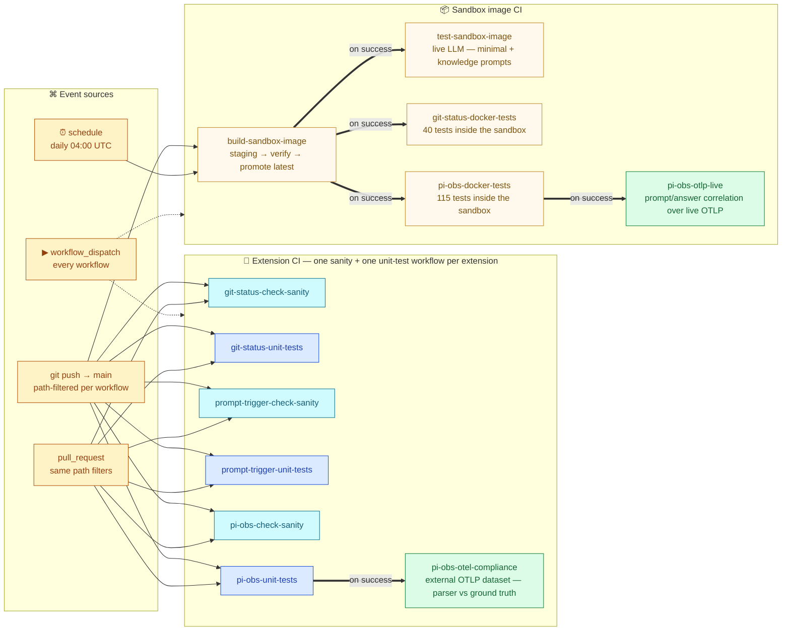

# CI — workflows, triggers, dependencies

Eleven GitHub workflows gate every artifact of this repo. This document
visualizes how they are triggered and how they chain into each other;
the workflows themselves live in [`.github/workflows/`](.github/workflows/).

## Trigger and dependency graph

## Reading the graph

- **Solid edges** — direct triggers: a push (path-filtered) or pull request
  runs the six extension workflows; the daily cron runs the image build.
- **Dotted edges** — `workflow_dispatch`: every workflow can also be run
  manually from the Actions tab.
- **Thick edges** — `workflow_run` success-gates: the downstream workflow
  runs only when the upstream completed successfully. A failure upstream
  means the downstream never starts.

## The chains

1. **Extension change** (e.g. `extensions/git-status/**`) →
   sanity gate (manifest, CHANGELOG, tsc, tarball, live-load smoke) →
   unit tests with coverage (job summary per-test report).

2. **pi-obs unit tests pass** → **OTLP compliance**: the parser runs
   against the largest external OpenTelemetry dataset in the repo
   (a real OpenTelemetry-demo export, ~117k spans, 17 services) with the
   parser's span count cross-checked against an independent ground truth.

3. **Image change** (or the daily 04:00 UTC cron) → **build-sandbox-image**:
   builds amd64+arm64, pushes the immutable `sha-` tag, pulls it back
   from GHCR, smoke-runs both platforms (entrypoint, pi, git/gh/node),
   then — and only then — promotes the verified digest to `latest`/`main`
   (+ `daily` on the cron, semver on version tags). A failed verification
   leaves `latest` pointing at the last good image.

4. **Image verified** → three parallel consumers:
   `test-sandbox-image` (live LLM: minimal prompt + knowledge prompt,
   both platforms), `git-status-docker-tests` (the extension's 40 tests
   inside the sandbox), `pi-obs-docker-tests` (115 tests inside the
   sandbox) → **pi-obs-otlp-live** (a real prompt through the sandbox
   with pi-obs exporting OTLP; the captured spans must correlate the
   prompt with the answer on one traceId, displayed as a span tree in
   the job summary).

## Shared machinery

| Script | Used by |
|---|---|
| `utils/check-extension.sh <name>` | the three `*-check-sanity` workflows |
| `utils/run-tests.sh <name> [paths…]` | the three `*-unit-tests` workflows |
| `config/otelcol-jaeger.yaml` | the `otlp-jaeger` compose service (consumed in production, not CI) |
| `extensions/pi-obs/tests/tools/validate-external-otel.mjs` | `pi-obs-otel-compliance` |
| `extensions/pi-obs/tests/tools/otlp-capture-receiver.mjs` · `validate-otlp-correlation.mjs` · `otlp-trace-summary.mjs` | `pi-obs-otlp-live` |

Every job summary carries the house formatting: thousand-separated
numbers, per-check ✅/❌ rows, and (for unit tests) the per-test table
with durations.
