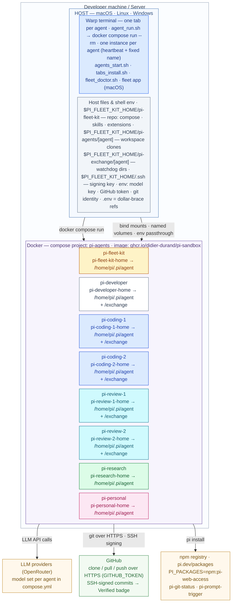

# 🚧 pi-fleet-kit — Work In Progress

> ⚠️ **WORK IN PROGRESS** — this project is under active development; breaking changes are expected and nothing is finalized yet.
>
> 🤖 **Note:** every artifact of this repo — code, docs included — is 100% automatically produced by a pair of (Pi Agent, GLM 5.3 Flash) running in the `pi-fleet-kit` container of the fleet itself. The repository is its own dogfood: the agent you get by running this solution wrote the solution.

pi-fleet-kit is a ready-made solution for running a **fleet of Pi coding agents on a single local machine** (desktop or server): each agent lives in its own Docker sandbox with fully isolated state — its own persistent home, its own workspace git clone, its own credentials — while sharing one image and one compose file. The fleet is operated from Warp tabs (or a macOS Dock app), with live per-agent git status and file-triggered prompts bridging automation to running sessions. The `pi-fleet-kit` agent instantiated by the solution is itself the configuration manager: prompt it with your requirements — more or fewer agents, different names, different skills or models — and it adapts the fleet's config (compose services, mounts, tab configs) accordingly.

See the dedicated READMEs: [extensions/intro](extensions/README.md),
[extensions/git-status](extensions/git-status/README.md),
[extensions/prompt-trigger](extensions/prompt-trigger/README.md),
[extensions/pi-obs](extensions/pi-obs/README.md),
[warp/](warp/README.md), [skills/](skills/), [docs/](docs/), [sources/](sources/).

## Running environment



The whole system in one picture: the host runs **Warp** (one tab per agent,
launching through `agent_run.sh`) and, on macOS, the **Pi Agent Fleet** Dock
app; Docker runs eight sandbox containers (image `ghcr.io/didier-durand/pi-sandbox`) from the `pi-agents` compose
project, each with its own
persistent Pi-home volume, its own workspace git
clone, and read-only mounts of this repo's skills/extensions; outside, the
agents talk to the model API (OpenRouter), GitHub (HTTPS auth + SSH commit
signing), and npm (Pi Packages, including this repo's published extensions).

## Machine requirements (portability)

No path in this repo is user-specific: all runtime paths derive from one
environment variable, **`PI_FLEET_KIT_HOME`** — the fleet root directory
(default: the host home). Expected layout under it:

- **`$PI_FLEET_KIT_HOME/pi-fleet-kit/`** — this repo (clone it there)
- **`$PI_FLEET_KIT_HOME/pi-agents/`** — agent workspace clones
- **`$PI_FLEET_KIT_HOME/pi-exchange/`** — watchdog exchange dirs
- **`$PI_FLEET_KIT_HOME/.ssh/pi-agent-signing`** — the agents' signing key

Export `PI_FLEET_KIT_HOME` (in your shell profile or `.env`) to relocate
the whole fleet — e.g. `PI_FLEET_KIT_HOME=/srv/fleet`. The default keeps
the classic layout. Everything else adapts per machine; tool lookup covers
the standard install locations on macOS (`/usr/local/bin`,
`/opt/homebrew/bin`, `$HOME/.docker/bin`) and Linux.

## Per-agent skills

Each agent loads **only the skills assigned to it** — defined in
`compose.yml` per service (mount the skill dir read-only, then pass
`--skill /repo-skills/<name>`, repeatable):

| Agent | Skills |
|---|---|
| `pi-fleet-kit` | `build-skill`, `github-best-practices` |
| `pi-developer` | `github-best-practices`, `write-specifications`, `write-implementation-plan` |
| `pi-coding-1` | `github-best-practices`, `write-code`, `write-pull-request` |
| `pi-coding-2` | `github-best-practices`, `write-code`, `write-pull-request` |
| `pi-review-1` | `github-best-practices`, `review-pull-request` |
| `pi-review-2` | `github-best-practices`, `review-pull-request` |
| `pi-research` | `publishing-best-practices`, `github-best-practices`, `web-research` |
| `pi-personal` | `publishing-best-practices`, `hello-world`, `github-best-practices`, `web-research` |

To change an agent's list: edit that service's two blocks in `compose.yml`
(the mounts under `volumes:` and the `--skill` flags under `command:`), then
relaunch the tab. Skills live in `skills/` and are mounted read-only, so
agents can never modify them; updates flow through `git pull`.

Infrastructure for running [Pi](https://github.com/earendil-works/pi-coding-agent)
coding agents in Docker sandboxes, with reproducible GitHub authentication
mirroring the host's setup.

## Contents

| File | Purpose |
|---|---|
| `compose.yml` | Defines the agent services. Currently eight agents — `pi-fleet-kit`, `pi-developer`, `pi-coding-1`, `pi-coding-2`, `pi-review-1`, `pi-review-2`, `pi-research`, `pi-personal` — all running the `ghcr.io/didier-durand/pi-sandbox` image (CI-published, public), each with its own persistent Pi-home volume and a bind-mounted workspace under `$PI_FLEET_KIT_HOME/pi-agents/`. |
| `Dockerfile.pi` | Builds the `pi-sandbox` image: Node 24 base, git + ripgrep + GitHub CLI (`gh`, from the official cli.github.com apt repo), `pi` installed globally, the entrypoint wrapper below, and a non-root `pi` user (least privilege — the agent runs unprivileged). CI also publishes it (private package) as `ghcr.io/didier-durand/pi-sandbox`. |
| `utils/gen-fleet-registry.sh` | Generates `fleet/agent-registry.md` (the fleet "who does what" table) from `compose.yml`; the `fleet/` directory is mounted read-only into every agent at `/fleet`. |
| `utils/check-extension.sh` · `utils/run-tests.sh` | CI helpers: per-extension sanity gate (manifest, CHANGELOG, tsc, npm-pack tarball, optional live-load smoke test) and unit tests under V8 coverage with a Markdown job summary — each driven by its own GitHub workflow. |
| `utils/entrypoint.sh` | Container entrypoint. Before handing off to `pi`, it configures the agent's git environment from env vars passed by Compose: commit identity (`GITHUB_USER_NAME`/`GITHUB_USER_EMAIL`) and a token-based git credential helper (`GITHUB_TOKEN`) — the container has no keyring, so auth must come from the environment. |
| `.env` | Credentials bridge for Compose. Holds **`${VAR}` references only** (e.g. `GITHUB_TOKEN=${GITHUB_TOKEN}`), resolved from the host shell when `docker compose` runs. |
| `.gitignore` | Excludes `.DS_Store`, coverage output and the legacy agent workspace (`finance-agent/`); agent workspaces now live outside this repo in `$PI_FLEET_KIT_HOME/pi-agents/`. |
| `.githooks/pre-commit` | Secret-leak guard (see below). |
| `package.json` | Pi package manifest (see below). |
| `skills/` | Installable Pi skills; each subdirectory holds a `SKILL.md` (Agent Skills spec). Currently `build-skill`, `github-best-practices`, `hello-world`, `publishing-best-practices`, `write-pull-request`, `review-pull-request`, `write-code`, `write-specifications`, `write-implementation-plan`, `web-research`, `prompt-agent`, `apply-pull-request`. |
| `extensions/` | Shared Pi extensions (`git-status`, `prompt-trigger` — also published as standalone npm Pi Packages, `pi-git-status` / `pi-prompt-trigger`) plus `pi-obs` (OpenTelemetry observability: live token/cost footer, `/pi-obs` reports, OTLP export to Jaeger) — see [extensions/README.md](extensions/README.md). |
| `fleet/` | Fleet-level files shared with agents: `agent-registry.md` (the generated who-does-what table), mounted read-only at `/fleet` in every container. |
| `docs/` | Supplementary docs (e.g. registering the agents' SSH signing key on GitHub). |
| `sources/` | Summaries of external sources informing the fleet's practices (e.g. `vuln-to-pr/` — a dataset of vulnerability-introducing pull requests). |
| `LICENSE` | MIT license text. |
| `warp/` | Warp editor config: Tab Configs for the agents (`tab_configs/`), a launcher (`agent_run.sh`), an all-agents launcher (`agents_start.sh`), a config installer (`tabs_install.sh`), a fleet diagnostic (`fleet_doctor.sh`), a macOS Dock app builder (`build_fleet_app.sh`), and feature-request drafts (`issues/`). |

## Fleet registry

`fleet/agent-registry.md` is the fleet's "who does what" table — generated
from `compose.yml` by `utils/gen-fleet-registry.sh` (compose stays the
single source of truth; never edit the registry by hand). It lists every
agent's Pi home volume, skills, extensions, Pi Packages, prompt-trigger state and
workspace. Every container mounts the whole `fleet/` directory read-only at
`/fleet` (room for future fleet-level files), so **agents can discover the
rest of the fleet** (compose.yml itself is not visible inside containers) —
e.g. the `pi-fleet-kit` agent reads `/fleet/agent-registry.md` when
reconfiguring the fleet. A pre-commit
hook regenerates the registry from any staged `compose.yml` change and
rejects commits that would let the two drift apart.

## Pi package (fetching skills from GitHub)

This repo is a valid [Pi package](https://github.com/earendil-works/pi-coding-agent/blob/main/docs/packages.md):
`package.json` declares the `pi-package` keyword and points Pi's `pi.skills`
manifest at `./skills`, so any agent can fetch its skills directly from this
GitHub repository with:

```bash
pi install git:github.com/didier-durand/pi-fleet-kit@v0.1.0
```

(Git tags and commits are pinned; `pi update --extensions` reconciles the
checkout without moving a pinned ref.)

Inside the Docker sandboxes, agents can do the same — `GITHUB_TOKEN` is
already passed through for git-over-HTTPS auth, so no extra login is needed:

```bash
pi install git:github.com/didier-durand/pi-fleet-kit@v0.1.0
```

Only the resources declared in the manifest (`skills/`) are loaded; the rest
of the repo (compose, Dockerfile, warp configs) is ignored by Pi.

## Community packages on npm

The two extensions are also published as standalone, individually
installable Pi Packages — no fleet-kit infrastructure required:

```bash
pi install npm:pi-git-status      # live git state in the pi footer
pi install npm:pi-prompt-trigger  # file-triggered prompts for a running TUI
```

Both carry the `pi-package` keyword and appear in the Pi package gallery.
See [extensions/README.md](extensions/README.md) for details and the
release workflow.


## Usage

```bash
# Run the agent (pulls ghcr.io/didier-durand/pi-sandbox:latest on first use —
# the package is public, no docker login needed):
docker build -t pi-sandbox -f Dockerfile.pi .

# Run the agent:
docker compose -f $PI_FLEET_KIT_HOME/pi-fleet-kit/compose.yml run --rm pi-personal

# Teardown (deletes volumes and ALL agent state):
docker compose -f $PI_FLEET_KIT_HOME/pi-fleet-kit/compose.yml down -v
```

### Agent workspaces must be git clones

Each agent works in its own independently cloned repository
(`$PI_FLEET_KIT_HOME/pi-agents/<agent>`, mounted as `/workspace`) — the `git-status`
footer extension is inactive otherwise. `warp/agent_run.sh` bootstraps this
at launch: `pi-fleet-kit`'s workspace (a clone of this repo, its natural
domain) is cloned automatically from the origin if missing; other agents'
workspaces are per-project clones only you know, so the launcher warns and
prints the exact `git clone` command when a workspace is not a repo.

### Environment variables passed to agents

| Variable | Sourced from | Used for |
|---|---|---|
| `OPENROUTER_API_KEY` | host env via `.env` reference | Pi's `openrouter` provider |
| `GITHUB_TOKEN` | host env via `.env` reference | `gh` CLI + git-over-HTTPS auth inside the container |
| `GITHUB_USER_NAME` | host env passthrough | git commit author name |
| `GITHUB_USER_EMAIL` | host env passthrough | git commit author email |

If these are exported in your shell, nothing else is needed. `.env` exists as
a fallback so the Compose file documents its own expectations.

> ⚠️ **CAUTION — `.env` must contain references, never literal secrets.**
> This file is tracked in git on purpose, and it can stay safe **only** as
> long as every value is a `${VAR}` placeholder resolved from the host
> environment. Writing a real token (e.g. `GITHUB_TOKEN=ghp_…`) into `.env`
> puts a live credential into git history — an irreversible leak, even in a
> private repo. The pre-commit hook below blocks this, but treat the hook as
> a seatbelt, not a licence.

## Secret-leak guard (pre-commit hook)

Every commit is scanned before it lands:

1. **`.env` policy** — any `*TOKEN*/*KEY*/*SECRET*/*PASSWORD*=` line must be
   a `${VAR}` reference, empty, or a quoted placeholder.
2. **All staged files** — checked against known token signatures (`ghp_`,
   `gho_`, `github_pat_`, `sk-or-v1-`, `sk-…`, `AKIA…`, `glpat-`, `xox…`,
   PEM private keys). Matches block the commit; only line numbers are
   reported, never the secret itself.

**Required one-time setup per clone** (git hooks are local config and do not
travel with the repo):

```bash
git config core.hooksPath .githooks
```

Emergency bypass (avoid): `git commit --no-verify`.

## Prerequisites

### Universal (the sandbox itself — no host-side Node/pi needed)

- **Docker + Compose v2**: Docker Desktop (macOS/Windows) or Docker Engine
  with the compose plugin (Linux). The `warp/` scripts also probe the usual
  Docker Desktop install locations (`/usr/local/bin`, `/opt/homebrew/bin`,
  `$HOME/.docker/bin`, `/usr/bin`), so launcher contexts with a minimal `PATH`
  work too. Where available, **Docker Desktop is a nice addition** beyond
  the engine itself: its GUI makes it efficient to inspect, start/stop and
  read logs of the agent containers without leaving the desktop.
- **The repo at `$PI_FLEET_KIT_HOME/pi-fleet-kit`** — the one path convention other files
  depend on (see [Machine requirements](#machine-requirements-portability)).
- **Credentials in the host shell** (the tracked `.env` holds only
  `${VAR}` references — the real values must be exported):
  `OPENROUTER_API_KEY`, `GITHUB_TOKEN`, `GITHUB_USER_NAME`,
  `GITHUB_USER_EMAIL`.
- **The sandbox image**: pulled from GHCR by default
  (`ghcr.io/didier-durand/pi-sandbox:latest` — CI-built and verified on
  every push, public package). To build and run a local image instead:
  `export PI_SANDBOX_IMAGE=pi-sandbox - **The sandbox image built once**:- **The sandbox image built once**: docker build -t pi-sandbox -f Dockerfile.pi .`
  `docker build -t pi-sandbox -f Dockerfile.pi .`
  (CI also publishes it as `ghcr.io/didier-durand/pi-sandbox`, multi-arch
  and verified on every push — private package for now; switching the
  fleet to it later is a one-line change per service.)
- **Git hooks configured once per clone**:
  `git config core.hooksPath .githooks`
- **Network access** at first launch: npm registry (the `PI_PACKAGES`
  auto-install of `pi-web-access`) and the model API.
- **Agent workspaces as git clones** under `$PI_FLEET_KIT_HOME/pi-agents/` (`git-status` is
  inactive otherwise) — see [Agent workspaces must be git
  clones](#agent-workspaces-must-be-git-clones).

### Warp terminal (the intended operating layer)

- [Warp](https://www.warp.dev) — available for macOS, Windows, and Linux
  (x64/ARM64).
- `warp/tabs_install.sh` then puts one tab config per agent into Warp's
  per-platform config directory (auto-detected on all three platforms).
- Every tab launches the agent through `warp/agent_run.sh`, which enforces
  **one instance per agent** (heartbeat claim, orphan healing, fixed
  container names) — plain `docker compose run` bypasses that discipline
  and is the headless fallback, not the primary interface.

### macOS capstone — the "Pi Agent Fleet" Dock app (optional)

- Built by `warp/build_fleet_app.sh` into `$HOME/Applications`: one Dock icon
  for the whole fleet (running-dot while agents are up, click-while-running
  convergence via `agents_start.sh`).
- Requires the Xcode Command Line Tools (`xcode-select --install`) for
  `swiftc`; without them it degrades to a basic osacompile launcher without
  the dot or click-while-running behavior.
- Linux/Windows: use the Warp tabs directly; the app is macOS-only.
